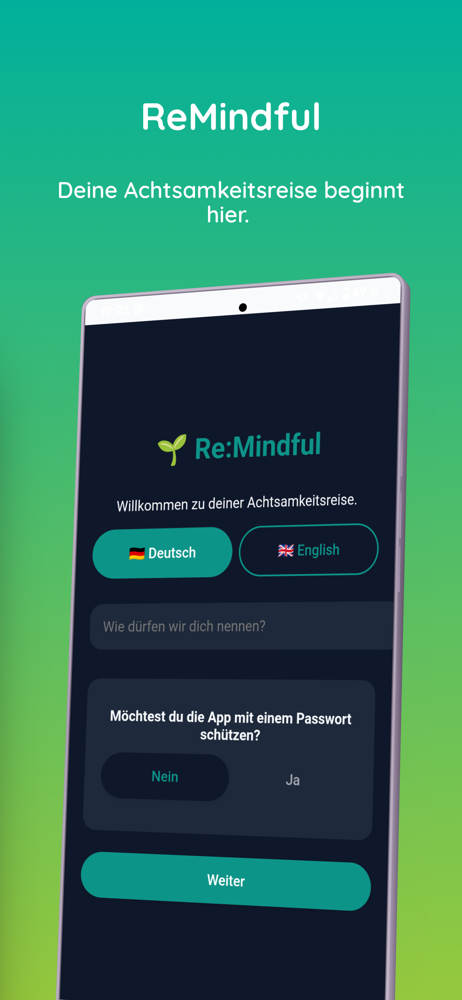
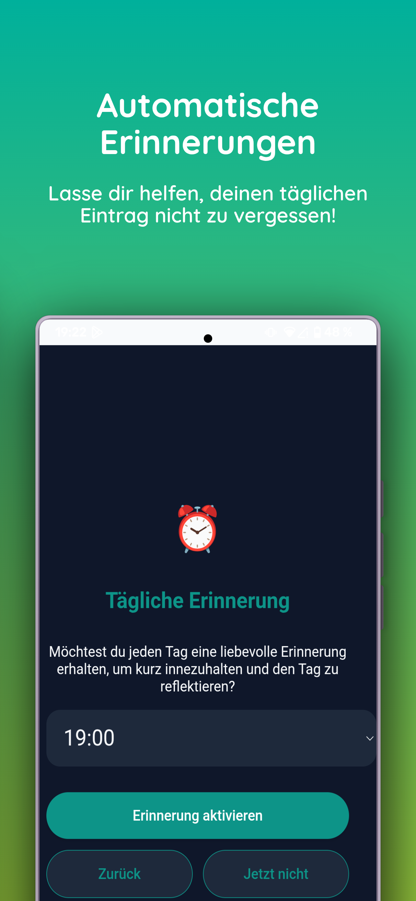
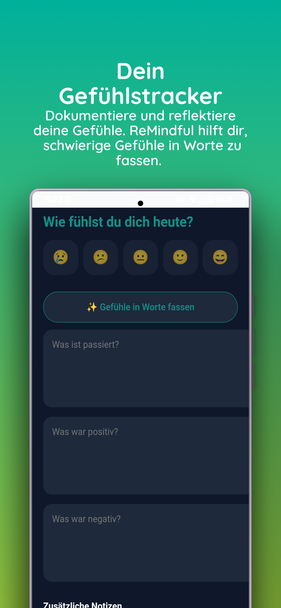
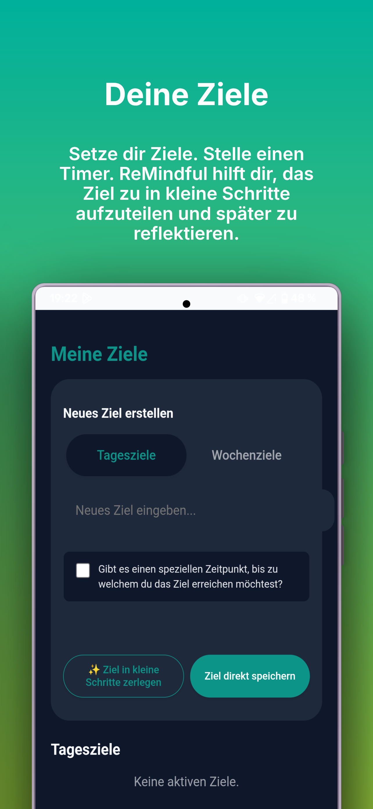
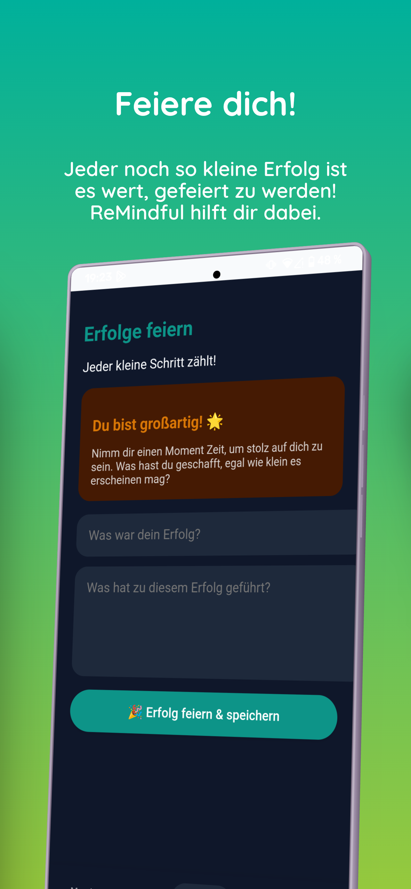
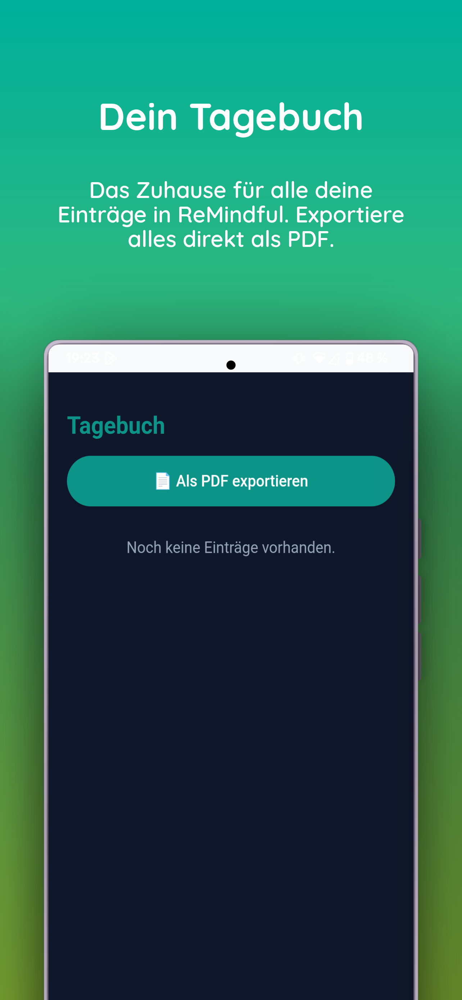
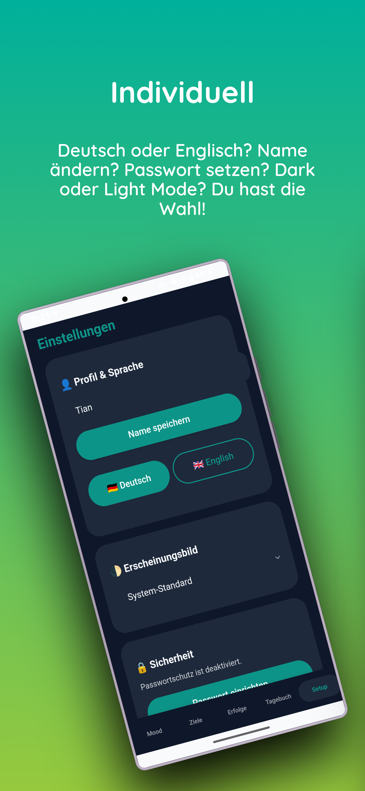
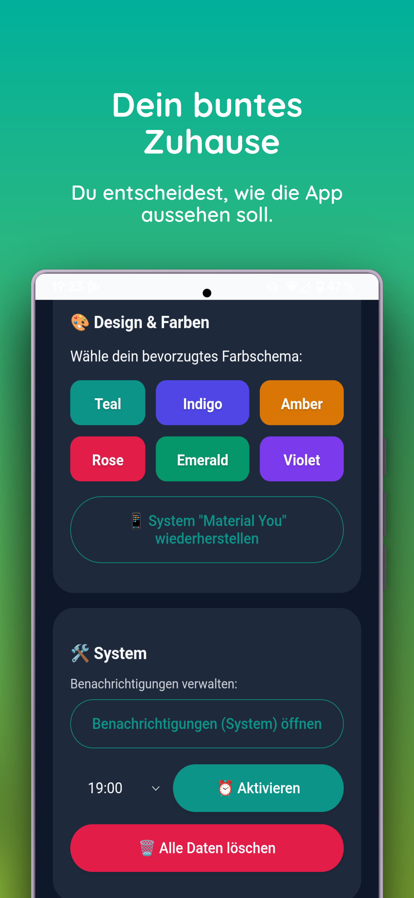

# 🌱 Re:Mindful – Mindfulness & Personal Growth

*(🇬🇧 English description below)*

## 🇩🇪 Deutsch

**Re:Mindful** ist eine datenschutzfreundliche, 100% offline funktionierende Tagebuch- und Achtsamkeits-App für Android. Sie hilft dir bei der Selbstreflexion, der flexiblen Zielsetzung mit Echtzeit-Timern und dabei, kleine Erfolge im Alltag bewusst zu feiern.

### 📱 Screenshots & Impressionen

  
  
  
  

  
  
  
  

### ✨ Hauptfunktionen & Neuerung Highlights (v2.6.0.0)
* **Echtzeit Live-Countdown & Flexible Timer:** Deine aktiven Ziel-Timer zählen ab sofort sekundengenau in Echtzeit rückwärts! Versehe Tagesziele (Standard: 24 Std., variabel 1 Min bis 6d 23h 59m) oder Wochenziele (Standard: 7 Tage, variabel 7d 1m bis 13d 23h 59m) mit individuellen Laufzeiten.
* **Automatisches Auswertungs-Popup:** Beim Öffnen des Ziele-Tabs prüft die App abgelaufene Ziele automatisch und öffnet ein Popup zur sofortigen Bewertung ("Voll", "Teilweise", "Nicht erreicht") oder zum Überspringen.
* **Timer neu stellen & Verlängern:** Du kannst abgelaufene Timer direkt im Popup oder auf der Zielkarte mit einem Klick neu stellen und verlängern.
* **Übersichtliche Ziele-Struktur & Nachbearbeitung:** Tages- und Wochenziele werden übersichtlich in separaten Abschnitten aufgelistet. Über den "Bearbeiten"-Button lassen sich Titel, Teilziele und Timer jederzeit nachträglich anpassen.
* **Direktes Speichern & NLP-Mikroziele:** Speichere Ziele direkt per Knopfdruck oder zerlege große Vorhaben in 11 Kategorien (z.B. Haushalt, Sport, Lernen) in winzige, druckfreie Schritte.
* **Mood-Tracker & Emotionale Reflexion:** Dokumentiere deine Stimmung inkl. Positiv/Negativ-Reflexion und Notizen. Die "Gefühle in Worte fassen"-Funktion hilft dir, Emotionen präzise zu beschreiben.
* **Swipe-to-Navigate:** Wechsle intuitiv durch leichtes Wischen nach links oder rechts zwischen den einzelnen Bereichen.
* **2-Step Onboarding:** Schneller Einstieg mit zweistufiger Ersteinrichtung (Sprache, Name, Passwortschutz & Uhrzeit für tägliche Erinnerungen inkl. Zurück-Button).
* **Dynamisches Design & Gefüllte Buttons:** Wähle zwischen Dark-, Light- oder System-Mode sowie 6 harmonischen "Material You"-Farbwelten mit ausgefüllten, elegant abgestimmten Buttons.
* **Tagebuch & PDF-Export:** Exportiere deine Einträge chronologisch als formatiertes PDF-Dokument direkt in deinen Downloads-Ordner.
* **Offline-First & Privacy by Design:** Alle Daten bleiben 100% lokal auf deinem Gerät. Keine Cloud, kein Tracking, kein Zwang.

### 🚀 Installation
Du kannst die fertige App direkt installieren, ohne sie selbst kompilieren zu müssen:
1. Gehe zu den [Releases](https://github.com/tsvie/ReMindful_2/releases/latest).
2. Lade dir die neueste `app-release.apk` (v2.6.0.0) herunter.
3. Führe die Datei auf deinem Android Smartphone aus.

### 🛠 Tech-Stack
* **Android / OS-Layer:** Kotlin, WebView, AndroidX, Native PDF & Notification APIs.
* **Frontend:** Vanilla JavaScript (ES6), HTML5, Native CSS (Material 3 Guidelines) – *als Single Page Application ohne schwerfällige Frameworks.*

> **Wichtiger Hinweis:** Re:Mindful dient deinem persönlichen Wachstum und der Selbstreflexion. Die App ist kein medizinisches Produkt und ersetzt keinen Arzt oder Psychotherapeuten.

---

## 🇬🇧 English

**Re:Mindful** is a privacy-first, 100% offline journaling and mindfulness app for Android. It assists you with self-reflection, goal setting with custom real-time timers, and consciously celebrating small everyday successes.

### 📱 Screenshots & Previews

  
  
  
  

  
  
  
  

### ✨ Key Features & Latest Highlights (v2.6.0.0)
* **Real-time Live Countdown & Custom Timers:** Goal timers now count down live every second! Set custom timers for Daily goals (Default: 24h, 1 min to 6d 23h 59m) and Weekly goals (Default: 7d, 7d 1m to 13d 23h 59m).
* **Automated Expiry Popup:** Upon switching to the Goals tab, the app automatically detects expired goals and displays a prompt for evaluation ("Achieved", "Partially", "Not achieved") or skipping.
* **Reset & Extend Timers:** Easily reset or extend expired goal timers directly within the popup or on individual goal cards.
* **Organized Goal Sections & Easy Editing:** Daily and Weekly goals are cleanly separated into dedicated lists. Edit goal titles, steps, and timers at any time.
* **Direct Add & Smart Micro-Goals (NLP):** Save goals directly or use the built-in NLP engine across 11 categories to break down overwhelming tasks into effortless micro-steps.
* **Mood Tracker & Emotional Reflection:** Record your mood along with positive/negative notes. The "Put feelings into words" assistant helps name complex emotions.
* **Swipe-to-Navigate:** Seamlessly swipe left or right to switch between screens.
* **Refined 2-Step Onboarding:** Simple setup flow covering Language, Name, Password protection, and Daily Reminders with full Back-button support.
* **Dynamic Appearance & Filled Theme Buttons:** Material You theme integration with 6 custom color palettes and sleek filled buttons matching your chosen palette.
* **Journal & PDF Export:** Export your formatted entries chronologically to a clean PDF saved straight to your Downloads folder.
* **Offline-First & Privacy by Design:** All data remains 100% locally on your phone. No cloud, no analytics, no trackers.

### 🚀 Installation
You can install the ready-to-use app without compiling it yourself:
1. Go to the [Latest Release](https://github.com/tsvie/ReMindful_2/releases/latest) page.
2. Download the latest `app-release.apk` (v2.6.0.0).
3. Run the file on your Android smartphone to install.

### 🛠 Tech Stack
* **Android / OS-Layer:** Kotlin, WebView, AndroidX, Native PDF & Notification APIs.
* **Frontend:** Vanilla JavaScript (ES6), HTML5, Native CSS (Material 3 Guidelines) – *built as a lightweight Single Page Application without heavy frameworks.*

> **Important Note:** Re:Mindful is designed for personal growth and self-reflection. It is not a medical device and does not replace professional therapy or a doctor.

---
*Developed with 💚 by Tian Svenja Vieth. Many thanks to L. for the ideas and feedback.*
